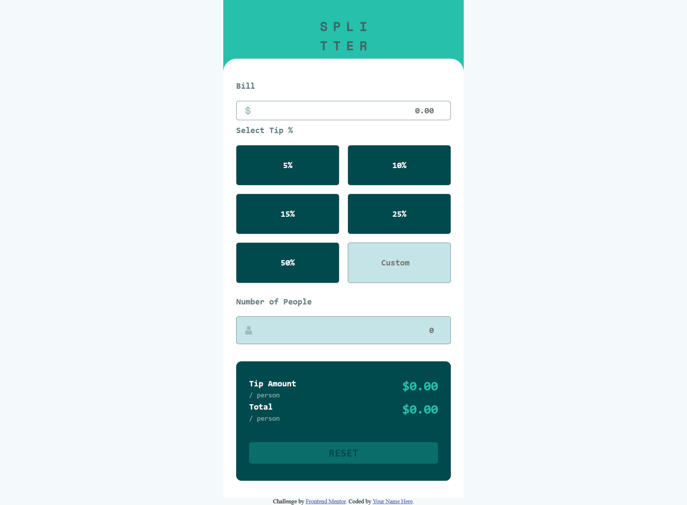

# Frontend Mentor - Tip calculator app solution

This is a solution to the [Tip calculator app challenge on Frontend Mentor](https://www.frontendmentor.io/challenges/tip-calculator-app-ugJNGbJUX). Frontend Mentor challenges help you improve your coding skills by building realistic projects.

## Table of contents

- [Overview](#overview)
  - [The challenge](#the-challenge)
  - [Screenshot](#screenshot)
  - [Links](#links)
- [My process](#my-process)
  - [Built with](#built-with)
  - [What I learned](#what-i-learned)
  - [Continued development](#continued-development)
  - [Useful resources](#useful-resources)
  - [AI Collaboration](#ai-collaboration)
- [Author](#author)

## Overview

### The challenge

Users should be able to:

- View the optimal layout for the app depending on their device's screen size
- See hover states for all interactive elements on the page
- Calculate the correct tip and total cost of the bill per person

Beyond the brief, the app also:

- Lets the user pick a preset tip (5%, 10%, 15%, 25%, 50%) or type a custom percentage
- Shows a "Can't be zero" error when the number of people is `0`
- Disables the Reset button when there is nothing to reset

### Screenshot



### Links

- Solution URL: [GitHub](https://github.com/Iyanu22/tip-calculator-app)
- Live Site URL: [Live URL](https://iyanu22.github.io/tip-calculator-app/)

## My process

### Built with

- Semantic HTML5 markup
- SCSS (variables and nesting), compiled to CSS
- Flexbox
- CSS Grid
- Mobile-first workflow
- Vanilla JavaScript (no frameworks)

### What I learned

**1. Keep state in variables and render from one function.**
My first version ran the calculation once at page load, so the results never changed. The fix was to let the event handlers only update state (`billAmount`, `tipPercentage`, `numberOfPeople`) and have a single `calculate()` function turn that state into what's on screen.

```js
billInput.addEventListener('input', () => {
    billAmount = Number(billInput.value);
    calculate();
});
```

**2. An early `return` skips everything below it.**
Putting the Reset button's disabled logic at the bottom of `calculate()` meant it never ran when the people field was `0`, because the error branch returns first. Work that must happen on every path goes before the early return.

```js
function calculate() {
    resetButton.disabled = /* nothing entered yet */;

    if (peopleZero) {
        // show error, set $0.00
        return;
    }
    // normal calculation
}
```

**3. Empty is not the same as zero.**
`Number('')` is `0`, so an empty field and a typed `0` look identical once converted. Checking the raw string (`peopleInput.value === ''`) before converting lets me show the error only for a real `0`.

**4. Nested SCSS changes your selectors.**
Rules nested inside `.container .header_body` compile to `.container .header_body .results`, so a media query with a shorter selector silently loses on specificity. Repeating the full selector chain in the media query fixed it. It also taught me that moving an element out of its parent in the HTML breaks every nested rule that depended on it.

**5. CSS details that made the UI feel right.**

- `&.active` (no space) targets the same element with the class, while `& .active` targets a descendant.
- `margin-top: auto` inside a flex column pins the Reset button to the bottom of the results panel.
- `:hover:not(:disabled)` stops a disabled button from reacting to the mouse.

```scss
#reset {
    &:hover:not(:disabled) {
        background-color: $green-200;
    }
    &:disabled {
        opacity: 0.3;
        cursor: not-allowed;
    }
}
```

### Continued development

- Accessibility: announce the results and the error message to screen readers (`aria-live`, `aria-describedby`), and make sure the selected tip is exposed with `aria-pressed`.
- Input limits: guard against negative numbers, very large values and non-integer people counts.
- Add automated tests for the calculation logic.
- Compare my spacing values against the design files at each breakpoint.

### Useful resources

- [MDN: Event: target property](https://developer.mozilla.org/en-US/docs/Web/API/Event/target) - Cleared up why `e.target.value` is the right way to read what the user typed.
- [MDN: CSS grid layout](https://developer.mozilla.org/en-US/docs/Web/CSS/CSS_grid_layout) - Reference for the two-column desktop layout and the 3-column tip grid.
- [Sass documentation: parent selector](https://sass-lang.com/documentation/style-rules/parent-selector/) - Explained how `&.active` and `&:hover` compile.
- [Conventional Commits](https://www.conventionalcommits.org/) - Used for commit message structure.

### AI Collaboration

I used Claude throughout this project for:

- **Debugging.** Finding why `e.tipPercentage` was undefined, why the results only calculated once, why the results panel rendered unstyled, and why the Reset state broke on the zero-people path.
- **Code review.** Reviewing my handlers and `calculate()` for edge cases such as empty versus zero input.
- **Explaining concepts.** Why `repeat(3, 1fr)` works, how `git add -p` works, and how SCSS nesting affects specificity.
- **Housekeeping.** Drafting commit messages and structuring this README.

What worked well: asking for the reasoning behind a fix, not just the fix, and testing each suggestion against edge cases in the browser before keeping it.

What didn't: my first desktop media query came from a screenshot, without accounting for my nested SCSS and HTML structure, so it didn't work as given. I only got the layout right after comparing it against my actual files. A suggestion is only as good as the context it was given, so I verify against my own code.

## Author

- Website - [Add your name here](https://www.your-site.com)
- Frontend Mentor - [@yourusername](https://www.frontendmentor.io/profile/Iyanu22)